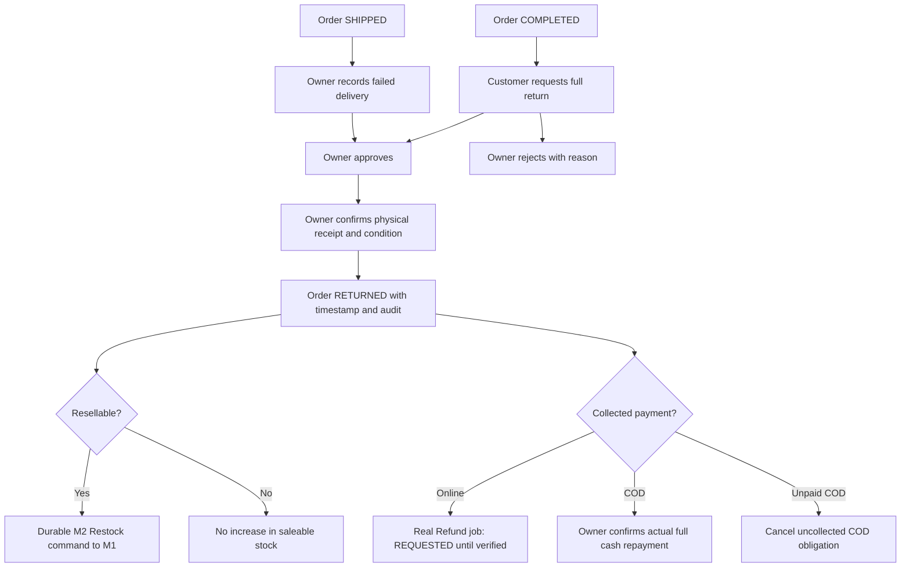

# ADR — Full-order returns and Owner approval of stock

Date: 27 October 2026. Decision: accepted for implementation following the user's explicit request for both failed-delivery returns and returns after the Customer receives the goods. This extends the prior MVP exclusion of returns after PROCESSING; partial returns, exchanges, disputes, settlement and production carrier/payment integrations remain outside this extension.

Keep M1 as stock owner, M2 as Order/Payment/Voucher owner, M3 as identity/Store authority and M4 as AI owner. No cross-database transaction or direct SQL access to another service is introduced. Existing member task ownership remains unchanged.

## State and transaction boundaries

One return case belongs to one complete Store Order. A rejected case is retained as the decision record; this release does not add repeated appeals or partial item quantities. Return request/approval does not change stock, declare cash refunded, or allow the Order to continue to completion while a return is active.

Receipt locks Order → Payment → inventory coordination → return case. Return status/history, inventory command intent and online refund intent commit in one caller-owned M2 transaction. Provider calls and M1 commands run outside the transaction through existing workers. Restock reuses the original consumed item snapshots and deterministic operation ID. Lost acknowledgements replay the same payload. Damaged returns use the explicit QUARANTINED coordination state and never enqueue Restock.

Online full refunds require successful PaymentAttempt evidence and stay subject to the configured provider. A disabled provider does not become success. COD refund is a separate, authenticated Owner acknowledgement of an actual cash repayment with an exact full amount; it records Refund, Payment balance, event and audit atomically. This is not a cash transfer API. Current refund policy is the full collected Order amount, including the original shipping charge, matching the existing full-payment-only Refund boundary.

Stock adjustments require Owner confirmation. Sellers with inventory permission can propose; only the Owner can approve/apply or reject. M1 saves the original requester, approving actor, receipt date, supplier/reference, server booking time, movement and audit. Approval uses the current inventory version and cannot consume another Store's Variant. Actual intake, count corrections, opening stock, stock issued to Orders and returned stock are distinct statistics. Historical unclassified increases stay visibly unclassified.

## Acceptance extension

| Check | Required evidence |
| --- | --- |
| DEMO-VOUCHER | Suggestions respect cart ownership/Store scope, spend thresholds and Customer/global quotas; selecting a code still requires a fresh authoritative quote. |
| DEMO-STOCK | Seller proposal has no stock effect; only Owner approval changes quantity; concurrent/repeated decisions apply once; receipt metadata and both actors are visible. |
| DEMO-RETURN-REQUEST | Foreign accounts, wrong states and stale versions are rejected; failed delivery and post-delivery Customer return remain separate origins. |
| DEMO-RETURN-RECEIPT | No restock before physical receipt; damaged goods are excluded; lost Restock ACK replays the immutable command. |
| DEMO-RETURN-CASH | Owner explicitly confirms cash repaid and exact amount; repeated/concurrent requests cannot refund twice; a failed audit rolls back all financial effects. |
| DEMO-RETURN-ONLINE | Refund intent requires collected-payment proof; failures roll back receipt intent; provider jobs never fabricate repayment. |
| DEMO-TRACE | Own Customer and authorized Store detail show shipping snapshot, actual creation/status timestamps, actor/reason, processing chain and separately authorized current stock. |

The 98-FR baseline keeps its original identifiers. This additive demo acceptance is recorded here and in [implementation and evidence](demo-operations.md); it does not silently turn previous exclusions or member tasks into completed work.
