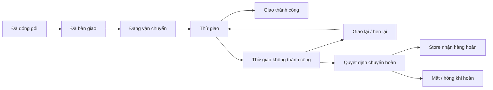

# Nghiên cứu nghiệp vụ TMĐT: Shopee và thiết kế đề xuất cho PBL6

Ngày đối chiếu: **27/10/2026**, múi giờ Việt Nam. Baseline code: **main `68072f5`**, sau [PR #136](https://github.com/embetapbay123/PBL6/pull/136). Checkout gốc trên máy có thể đang ở revision khác; các nhận xét dưới đây căn cứ baseline này.

Đây là **nghiên cứu và đề xuất spec**, chưa thay contract/runtime, chưa đổi acceptance, owner, issue hay lịch demo. Những phần đã triển khai đọc tại [nhật ký kiểm chứng](ecommerce-completion-progress.md) và [giao nhận hiện tại](order-fulfillment.md). [Ma trận tình huống](ecommerce-spec-scenarios.md) đi cùng tài liệu này dùng để duyệt thiết kế trước khi code.

## 1. Cách sử dụng nguồn và phạm vi kết luận

Phân biệt ba lớp: **tài liệu Shopee công khai mô tả gì**, **PBL6 đang làm gì**, **PBL6 nên thiết kế gì**. Không xem một trang hướng dẫn giao diện là bằng chứng về database, service hay thuật toán nội bộ của Shopee. Không mặc định mọi tài khoản đều có tính năng được mô tả trong tài liệu Kênh Quản Lý Shop (KQLS).

Chính sách vận chuyển hiện hành đọc ở trang 77250, có mốc cập nhật **15/9/2026**; không dùng bản 11/12/2025 hoặc 20/3/2026 để khẳng định chính sách hiện tại. Chính sách trả hàng trang 77251 ghi hiệu lực **11/3/2026**. Bài FAQ, chương trình VIP và điều khoản từng voucher có thể khác nhau; khi có ngoại lệ phải lưu đúng phạm vi/phiên bản, không hợp nhất thành một quy tắc chung. Đây không phải đánh giá tuân thủ pháp luật của PBL6. [Chính sách vận chuyển](https://help.shopee.vn/portal/4/article/77250), [chính sách trả hàng](https://help.shopee.vn/portal/4/article/77251).

| Nguồn chính thức | Quan sát phục vụ thiết kế |
| --- | --- |
| [Theo dõi trạng thái đơn](https://help.shopee.vn/portal/4/article/79472) | Có các nhóm chờ xác nhận/lấy hàng, đang giao, đã giao, hủy và trả hàng; mã vận đơn dùng để tra cứu hành trình. Nhóm giao diện không phải toàn bộ trạng thái nội bộ. |
| [Giao không thành công](https://help.shopee.vn/portal/4/article/206961) | Có nhiều nguyên nhân, liên hệ/giao lại rồi mới chuyển hoàn. Khoản trả trước có luồng hoàn tiền riêng. |
| [Shopee Đảm Bảo](https://help.shopee.vn/portal/4/article/79314) | Nút xác nhận nhận hàng không đồng nghĩa mọi quyền trả hàng kết thúc; thời hạn được tính từ mốc giao thành công theo chính sách. |
| [Trả hàng/hoàn tiền](https://help.shopee.vn/portal/4/article/77251) | Có điều kiện theo loại hàng/lý do, bằng chứng và phản hồi của các bên; thời hạn chung và ngoại lệ không giống nhau. |
| [Các loại voucher](https://help.shopee.vn/portal/4/article/79250), [thứ tự tính](https://help.shopee.vn/portal/4/article/85353) | Shop Voucher, Shopee Voucher và ưu đãi phí giao có vai trò khác nhau; giảm phí giao không trừ vào tiền hàng. |
| [Hoàn mã khi hủy](https://help.shopee.vn/portal/4/article/79148), [hoàn mã khi trả hàng](https://help.shopee.vn/portal/4/article/188931) | Loại mã, hạn dùng, toàn bộ/một phần và các đơn dùng chung mã ảnh hưởng việc hoàn mã. Không có quy tắc phổ quát “hủy là trả lại mọi mã”. |
| [Quản lý đơn KQLS](https://help.shopee.vn/portal/1/article/98754) | Có khâu chuẩn bị, đóng gói và bàn giao; bộ lọc theo SKU, shop, ngày, thanh toán và các loại phiếu. Không nên chỉ có một nút “chuyển trạng thái”. |
| [FAQ KQLS](https://help.shopee.vn/portal/1/article/98755) | KQLS quản lý xuất/nhập tồn, không đồng nghĩa lưu hàng tại kho Shopee; cảnh báo nhiều nguồn cùng sửa tồn. |
| [Xử lý đơn giao thất bại KQLS](https://help.shopee.vn/portal/1/article/102523) | Người bán đối chiếu hàng về, nhập lại hàng hoặc ghi nhận thất thoát/hư hỏng; có phiếu và giao dịch liên quan. |
| [Nhận hàng mua — Microsoft](https://learn.microsoft.com/en-us/dynamics365/supply-chain/procurement/product-receipt-against-purchase-orders), [nhật ký kho](https://learn.microsoft.com/en-us/dynamics365/supply-chain/inventory/inventory-journals) | Nguồn tham khảo ERP bổ sung: nhận hàng khác đặt mua, có kiểm chất lượng/nhận nhiều lần, bút toán đảo và loại nghiệp vụ kho. Không gán các chi tiết này cho Shopee. |

## 2. Kết luận kiến trúc nghiệp vụ

PBL6 cần quản lý **hàng đi đâu, ai giữ hàng, ai giữ tiền, quyền lợi nào còn hiệu lực**, bên cạnh màn hình đặt đơn. Một trường `order.status` không thể trả lời đủ các câu này.

| Trục | Câu hỏi phải trả lời | Mô hình đề xuất, chưa phải enum hiện có |
| --- | --- | --- |
| Order | Đơn được chấp nhận, đang thực hiện hay đã đóng? | OPEN / CONFIRMED / FULFILLING / COMPLETED / CANCELLED / CLOSED |
| Fulfillment | Đã lấy đủ hàng, đóng gói và bàn giao chưa? | UNALLOCATED / ALLOCATED / PICKING / PACKED / HANDED_OVER |
| Shipment | Kiện đang ở đâu? Có giao lại/hoàn về không? | WAITING_PICKUP / IN_TRANSIT / OUT_FOR_DELIVERY / DELIVERED / RETURNING / RETURNED / LOST |
| Payment và COD | Khách đã trả bao nhiêu? Tiền đang ở người thu hay đã đối soát? | Collection và COD remittance là các bản ghi riêng |
| Return | Khiếu nại gì, trả món nào, nhận lại bao nhiêu? | Case, dòng hàng, hành trình trả, kiểm nhận và quyết định |
| Refund | Đã yêu cầu hay đã thực sự trả tiền? | Intent → processing/pending/unknown → kết quả xác minh |
| Inventory | Hàng còn bán, đã phân bổ, cách ly hay đã rời kho? | Bucket/ledger và movement theo chứng từ |
| Settlement | Shop được hưởng và đã nhận khoản nào? | Pending / held / available / paid / adjusted |

Đây là mô hình mục tiêu, **không đề xuất đổi hết enum đang chạy ngay**. Có thể bổ sung entity phụ và ánh xạ UI trước; chuyển nghĩa trạng thái phải có migration, compatibility và kiểm tra recovery. `DELIVERY_FAILED` của bản hiện tại biểu diễn kết luận giao thất bại/chuyển sang Return, chưa biểu diễn từng lần thử giao.

Giữ **4 service**: M1 quản lý Product/Variant/kho/nhập hàng; M2 quản lý Checkout/Order/Shipment/Voucher/Payment/Return/Refund và đối soát; M3 quản lý tài khoản/Store/quyền/địa chỉ; M4 nhận event cho AI. Giao nhận và nhập hàng không phải lý do tự động tách thêm service. Mỗi service ghi database của mình; thay đổi liên service qua contract, outbox/inbox và lệnh idempotent.

## 3. Đơn hàng: đặc tả cần sâu hơn

### 3.1 Định danh, snapshot và quyền thực hiện

- Một lượt mua nhiều Store là PurchaseGroup; mỗi Store có Order độc lập. Hủy/hoàn một Order không tự hủy đơn anh em hoặc trả toàn bộ voucher chung.
- OrderItem giữ Variant, tên/thuộc tính/SKU lúc mua, số lượng, giá, phân bổ giảm giá và các giá trị đã thanh toán. Thay giá/ảnh/SKU sau này không viết lại đơn cũ.
- Địa chỉ gửi, nhận, trả hàng; phương thức/phí giao; policy và thời hạn cần snapshot. Sửa sổ địa chỉ không đổi kiện đã gửi. Sửa địa chỉ trước bàn giao phải được kiểm lại dịch vụ/phí và xác nhận nếu tổng tiền thay đổi.
- Giai đoạn đầu: khóa nội dung hàng sau Confirm; khách muốn đổi Variant/số lượng thì hủy hợp lệ và đặt lại. Chưa cung cấp nút sửa đơn nếu chưa có repricing, quota, stock và payment adjustment tương ứng.
- Backend trả `available_actions`, lý do không được thao tác và deadline dựa trên quyền + trạng thái + policy; FE không chỉ đoán từ `status`. Đây là contract mở rộng đề xuất.

### 3.2 Ma trận hành động tối thiểu đề xuất

| Thời điểm | Người mua | Store | Hệ thống/Admin |
| --- | --- | --- | --- |
| Chờ thanh toán | Thanh toán hoặc hủy | Đọc đơn; chưa giao | Hết hạn → giải phóng giữ hàng sau đối soát; tiền đến muộn → Refund intent |
| Đã xác nhận, chưa lấy/đóng gói | Hủy trực tiếp theo cutoff | Chuẩn bị, báo thiếu hàng | Theo dõi SLA; không tự hoàn tiền chỉ vì đã đóng đơn |
| Đang chuẩn bị, chưa bàn giao | Gửi yêu cầu hủy | Chấp nhận/từ chối với lý do, dừng bàn giao nếu đã chấp nhận | Giải quyết quá hạn; cạnh tranh giữa hủy và bàn giao phải có một kết quả |
| Đã bàn giao | Theo dõi, yêu cầu hỗ trợ; không hủy tức thì | Không tự kéo về PENDING | Luồng chặn giao/hoàn về nếu dịch vụ hỗ trợ; giữ lịch sử và trách nhiệm phí |
| Giao thành công | Xác nhận nhận hàng; yêu cầu sau mua trong hạn | Cung cấp chứng từ, phản hồi case | Không đồng nhất giao xong với hết quyền trả hàng hoặc đã thanh toán cho Shop |
| Đang có Return/Dispute | Theo dõi, cung cấp bằng chứng, hủy yêu cầu nếu policy cho phép | Phản hồi/kiểm nhận | Giữ phần tiền liên quan; không đóng case khi Refund còn UNKNOWN |

Ma trận này là **đề xuất PBL6**. Tài liệu KQLS mô tả yêu cầu hủy cần phản hồi và khâu đóng gói; không suy ra mọi giai đoạn của mọi loại đơn Shopee đều cho hủy như nhau. [Quản lý đơn KQLS](https://help.shopee.vn/portal/1/article/98754).

### 3.3 Deadline, exception và thông báo

Mỗi deadline cần `starts_at`, `due_at`, policy version, múi giờ và cách tính ngày lịch/ngày làm việc. Xác nhận/gửi hàng, phản hồi yêu cầu hủy, giao dự kiến, gửi trả và phản hồi khiếu nại là các đồng hồ khác nhau. Đơn online chưa trả tiền không nên chạy cùng mốc chuẩn bị như đơn đã trả. Khách phải thấy điều gì đang chờ và bước tiếp theo.

Ngoại lệ cần hàng đợi riêng: thiếu hàng sau kiểm đếm, chờ bàn giao quá hạn, mất kiện, giao báo thành công nhưng khách chưa nhận, tiền đến sau hủy, Refund chưa rõ kết quả, lệnh kho chưa ACK. Mỗi ca có owner xử lý, SLA, lịch sử quyết định và việc còn chờ; không dùng log kỹ thuật làm giao diện xử lý nghiệp vụ.

## 4. Giao nhận: vòng đời của kiện hàng

### 4.1 Chuẩn bị và tạo kiện

Đề xuất `Shipment` và `ShipmentItem(order_item_id, quantity)` tách khỏi Order. Baseline chỉ cho **một kiện toàn đơn**; nhiều kiện là bước sau, không thêm nút chia kiện trước khi có ràng buộc tổng lượng. Sau này: tổng lượng đã gán kiện không vượt lượng cần giao; giao lại cùng kiện không tạo một lần xuất kho mới.

Kiện cần địa chỉ gửi/nhận/trả đã snapshot, dịch vụ, mã vận đơn, trọng lượng/kích thước, dự kiến giao, phí dự kiến và nguồn giá. Mã vận đơn có unique theo provider/account phù hợp; mã tự giao dùng namespace riêng. Phiếu đóng gói là hàng cần lấy, biên bản bàn giao là hàng thực giao cho người vận chuyển; hai chứng từ có ý nghĩa khác nhau.

Phí giao không mặc định là hằng số của Store: cần xét tuyến, dịch vụ, kiện, điều kiện COD và mặt hàng; phí báo giá khác phí bị đối soát sau cân đo. Chênh lệch có người chịu theo policy, không tự thu thêm khách sau Confirm. Chính sách Shopee công khai yêu cầu thông tin kiện và quy định trách nhiệm về kích thước/khối lượng; chi tiết ràng buộc phụ thuộc dịch vụ. [Chính sách hiện hành](https://help.shopee.vn/portal/4/article/77250).

### 4.2 Thử giao khác kết luận không giao được

Mỗi `DeliveryAttempt` có số lần, mốc thực tế, lý do chuẩn hóa, ghi chú, bằng chứng và người/nguồn cập nhật. `recipient_absent`, `unreachable`, `address_invalid`, `refused`, `carrier_issue` không nên đều thành “khách không nhận”. Quyết định giao lại/chuyển hoàn được ghi riêng. FAQ Shopee mô tả nhiều lần liên hệ và khả năng hẹn/giao lại; không dùng số lần trong FAQ làm hằng số chung cho mọi dịch vụ PBL6. [Giao không thành công](https://help.shopee.vn/portal/4/article/206961).

### 4.3 Event, bằng chứng và thời điểm

Lưu cả `occurred_at` và `received_at`, provider event ID, trạng thái chuẩn hóa, raw-code đã lọc PII, nguồn MANUAL/CARRIER và actor. Inbox chống lặp. Event cũ vẫn vào lịch sử nhưng không được kéo DELIVERED ngược thành IN_TRANSIT. Sửa kết luận sai phải có Correction/Dispute record, không sửa/xóa âm thầm lịch sử.

Store tự giao phải hiện rõ nguồn thủ công. Căn cứ nhận hàng có thể là mã/biên bản hợp lệ và thông tin người xác nhận; file upload cần giới hạn dung lượng/loại, quét nội dung, quyền xem và thời hạn lưu. Không công khai ảnh chữ ký, điện thoại, địa chỉ hay tọa độ trong event M4.

Tách `delivered_at` của vận chuyển, `buyer_confirmed_at`, `completed_at`, `return_deadline_at`, `settled_at`. PBL6 hiện hoàn tất bằng xác nhận Store + thu đủ tiền; còn thiếu xác nhận người mua, cửa sổ sau mua và cơ chế kết thúc theo policy. Tài liệu Shopee nói rõ khách vẫn có thể yêu cầu trả hàng trong hạn sau khi đã bấm nhận hàng. [Shopee Đảm Bảo](https://help.shopee.vn/portal/4/article/79314).

### 4.4 Điểm nối kỹ thuật và nghiệp vụ

Adapter vận chuyển đề xuất cần báo giá, tạo/tra cứu/hủy vận đơn và đọc sự kiện. `CreateLabel` là command có mã ổn định và đối soát sau timeout; không tự tạo vận đơn thứ hai khi chưa rõ kết quả. Hủy nhãn phải có ACK/lookup trước khi khẳng định đã chặn hãng giao. Các tên operation/event dưới đây là blueprint, chưa được thêm vào 11 internal operation hoặc 7 event đang dùng.

| Việc | Nguồn xác nhận | Phần ghi trong service sở hữu |
| --- | --- | --- |
| Confirm/giữ hàng | M2 coordinator, M1 reservation ACK | Giữ contract/recovery hiện có; không lấy Cart làm giữ tồn |
| Đóng gói/bàn giao | Store có quyền, số lượng đã kiểm hoặc carrier ACK | M2 lưu nghiệp vụ/Shipment/audit/outbox cùng transaction |
| Ghi xuất vật lý mới | Lệnh M2 gửi M1 có nguồn ShipmentItem | M1 kiểm lượng được phân bổ, ghi ledger một lần; ACK mất thì replay cùng mã |
| Nhận hàng hoàn | Người kiểm nhận có quyền và chứng từ | M2 ghi ReturnReceipt/intent; M1 nhận disposition theo lượng đã duyệt |
| Thu/hoàn/đối soát | Payment provider hoặc chứng từ COD đúng loại | M2 ghi journal và audit; không nhận con số tổng từ FE làm bằng chứng ngân hàng |

Nếu ledger M1 chưa ACK, M2 cần hiển thị đang đồng bộ/đối soát thay vì cho nhập tay lặp để “sửa tồn”. Không mở transaction SQL bao quanh network call, không dùng transaction chung bốn database. Sổ sự kiện phải liên kết được `Order → Shipment/ReturnItem → movement → payment/refund`, không dùng correlation ID thay cho business identity.

## 5. Trả hàng, Refund và đối soát

Ba trường hợp cần tách: **giao thất bại/chưa nhận**, **đã nhận nhưng trả hàng**, **hoàn tiền không thu hồi hàng**. Mỗi loại có điều kiện, bằng chứng, trách nhiệm phí và quyết định khác nhau. Spec không nên bắt mọi Refund đều chờ hàng về, cũng không mặc định cứ tạo case là được hoàn. Chính sách Shopee có các nhánh xử lý và ngoại lệ theo hàng/lý do; thông số PBL6 phải được công bố riêng. [Chính sách trả hàng](https://help.shopee.vn/portal/4/article/77251).

Ví dụ đã xác minh ở nguồn này: hạn chung được nêu là **15 ngày từ giao thành công**, trong khi thực phẩm tươi sống/đông lạnh có hạn **24 giờ**. Vì vậy policy PBL6 cần theo loại hàng và mốc giao; không chỉ có một số ngày tính từ status COMPLETED. Các con số là tham chiếu chính sách Shopee tại ngày nghiên cứu, chưa được áp vào runtime PBL6. [Điều 3.2](https://help.shopee.vn/portal/4/article/77251).

`ReturnCase` cần các dòng `ReturnItem`, lượng yêu cầu/duyệt/đã gửi/nhận tốt/nhận hỏng/từ chối nhận. Case có vòng phản hồi, quyết định, căn cứ và khả năng khiếu nại. Kiện hàng trả có mã/hành trình riêng, không ghi đè Shipment gốc đã giao thành công. Baseline toàn đơn/một hồ sơ và `restock` chung chưa thể biểu diễn một món tốt, một món hỏng hoặc trả một phần số lượng.

Nhận hàng hoàn là kiểm đếm thực tế. Hàng tốt mới đủ điều kiện Restock; hỏng/cần kiểm tra vào bucket cách ly; thiếu/mất tạo exception, không cộng tồn giả. Refund có thể theo kết quả khác tùy policy/trách nhiệm; giải quyết quyền lợi khách không đồng nghĩa kho đã nhận đủ. Hướng dẫn KQLS cũng phân biệt nhập lại hàng và ghi nhận hư hỏng/thất thoát. [Xử lý hàng giao thất bại](https://help.shopee.vn/portal/1/article/102523).

Mỗi Refund intent có breakdown tiền hàng/phí giao, dòng được hoàn, operation ID, provider reference và kết quả đối soát. `pending`/`unknown` không cộng tiền đã hoàn. Lũy kế hoàn xác minh không vượt tiền đã thu được phân bổ; nhiều yêu cầu đồng thời phải lock cùng hạn mức. COD đã thu cần cả luồng ghi nhận hoàn và chứng từ; COD chưa thu không tạo “hoàn tiền” bằng số phải thu.

**Ràng buộc cần migration thật:** baseline có một Return/Order, một Refund/Payment và kiểm Refund bằng toàn bộ tiền thu/phải trả, gồm phí giao theo ADR hiện có. M1 `RestockOrder` kiểm khớp toàn bộ lượng đã Consume. Không thể mở partial return chỉ bằng ô nhập số tiền hoặc bỏ một `if`: phải thiết kế giữ hạn mức Refund, nhiều intent, lượng ReturnItem và lệnh Restock theo receipt riêng, đồng thời giữ replay các lệnh toàn đơn cũ. [ADR hiện tại](adr-demo-returns.md), [Refund service](../../backend/commerce-service/src/payment/refund.service.ts), [refund runtime schema](../../backend/commerce-service/migrations/008_refund_runtime.sql), [Inventory service](../../backend/catalog-service/src/inventory/inventory.service.ts).

Tách **khách đã trả**, **shipper thu COD**, **đơn vị vận chuyển đã chuyển tiền**, **Shop được hưởng**, **Shop đã nhận**. Trạng thái Payment SUCCEEDED hiện tại chưa phải sổ đối soát COD/settlement marketplace. Hạn trả hàng, tranh chấp và điều chỉnh sau thanh toán cần được tính riêng. Không chép tỷ lệ phí hoặc lịch trả tiền Shopee vào PBL6 khi chưa thiết kế commission/funding ledger. [Điều khoản Shopee, phần thanh toán](https://help.shopee.vn/portal/4/article/77243).

## 6. Voucher và giá tiền: spec phải giải thích được từng đồng

### 6.1 Các khái niệm cần tách

| Khái niệm | Ý nghĩa cần thiết kế |
| --- | --- |
| Campaign / Rule version | Ai phát hành/tài trợ, thời gian, scope, điều kiện và ngân sách |
| Claim / Kho mã của người mua | Người nào đã lưu/được cấp mã; lưu không đồng nghĩa giữ một lượt ngân sách |
| Eligibility | Tập dòng đủ điều kiện, cơ sở tính min spend, người dùng/Store/địa bàn/payment/channel phù hợp |
| Reservation | Lượt/ngân sách tạm giữ cho Confirm đang xử lý, có TTL và recovery |
| Redemption | Quyền lợi đã gắn với lần mua/đơn; có phân bổ và trạng thái ổn định |
| Reissue / Entitlement restore | Quyết định cấp lại quyền dùng theo policy sau hủy/hoàn; khác release một reservation chưa commit |

Shop Voucher giảm hàng của một Store; Platform Voucher giảm các dòng đủ điều kiện trong lượt mua; Shipping Voucher giảm phần phí giao đủ điều kiện. Cashback/coins là quyền lợi phát sinh sau này, không tự là giảm ngay tiền phải trả. Shopee công khai ba nhóm mã và thứ tự Shop → Shopee → ưu đãi phí giao; đây là tham chiếu phù hợp cho PBL6. [Loại mã](https://help.shopee.vn/portal/4/article/79250), [cách tính](https://help.shopee.vn/portal/4/article/85353).

### 6.2 Bộ quy tắc đề xuất

- Version bất biến cho giao dịch đã Confirm; Shop thay mức giảm/hạn mức không sửa discount của Order cũ.
- Min spend cần ghi rõ tính theo dòng eligible nào và trước/sau giảm Shop; không để FE, BE và mô tả mã dùng ba cơ sở khác nhau.
- Khóa điều kiện stacking/exclusion: mỗi Store tối đa một mã hàng, một mã hàng cấp sàn cho nhóm eligible, một ưu đãi phí giao theo policy. Không coi đây là giới hạn cố định của Shopee.
- Có tổng lượt, lượt mỗi khách và ngân sách tiền. Reservation đồng thời phải tính cả lượt lẫn ngân sách; UI “còn lượt” không bảo đảm Confirm thành công sau đó.
- Quote không giữ quyền lợi vô thời hạn; Confirm revalidate cùng version và bảo lưu/quyết toán theo transaction/recovery hiện có. Mất ACK không tạo lượt dùng thứ hai.
- Gợi ý mã phải chạy chung pricing engine với Quote và trả lý do không dùng được, số tiền thiếu để đạt ngưỡng và ảnh hưởng khi chọn mã khác. “Ưu đãi tốt nhất” phải so sánh **tổ hợp hợp lệ**, không lấy từng mã giảm nhiều nhất độc lập rồi cộng.
- Tiền integer VND; nhân/chia dùng số nguyên với chính sách làm tròn xác định. Tổng phân bổ cấp dòng bằng tổng discount; tie-break ổn định; không phân bổ vượt tiền eligible của dòng.
- Giá vận chuyển, phần được giảm, bên tài trợ và phần khách trả phải tách cột. Khách vẫn có thể trả phí giao khi ưu đãi có trần hoặc không bao hết các kiện. [FAQ freeship](https://help.shopee.vn/portal/4/article/79243).

Mã giới hạn người mới/khách được cấp cần bằng chứng từ identity và lịch sử quyền lợi, không tin cờ `is_new_customer` do FE gửi. Tách quyền tạo chiến dịch, cấp ngân sách, khóa mã và xử lý cấp lại. Chặn việc đổi scope/tài trợ của chiến dịch đã có giao dịch để chuyển chi phí cho bên khác. Rate limit và dấu hiệu dùng mã bất thường tạo exception có review; không mặc định thu thập thêm dữ liệu nhạy cảm chỉ để bắt chước hệ thống chống gian lận của sàn lớn.

### 6.3 Hủy/hoàn và voucher

Không viết `cancelOrder → decrement voucher.used_count` cho mọi trường hợp. Cần ma trận theo issuer, toàn bộ/một phần, nguyên nhân, voucher expiry, sibling Orders và entitlement. FAQ Shopee về hủy nói đến các đơn dùng chung mã và có khác biệt giữa loại mã; trang về trả hàng còn phân biệt khiếu nại toàn bộ/một số sản phẩm. [Hoàn mã khi hủy](https://help.shopee.vn/portal/4/article/79148), [khi trả hàng](https://help.shopee.vn/portal/4/article/188931).

Một ví dụ cần tránh đọc lướt: FAQ hoàn mã chung nêu không hoàn mã phí giao, trong khi trang ShopeeVIP mô tả việc cấp lại ưu đãi phí giao khi toàn bộ phần dùng chung đáp ứng điều kiện. Phải kiểm phạm vi chương trình/điều khoản, không lấy một câu FAQ làm rule chung hoặc tự kết luận mọi tài khoản được hưởng ngoại lệ. [FAQ chung](https://help.shopee.vn/portal/4/article/79148), [điều kiện ShopeeVIP](https://help.shopee.vn/portal/4/article/178771).

**Đề xuất PBL6 giai đoạn đầu:** reservation chưa commit được release khi thất bại chắc chắn/hết hạn đã đối soát. Sau commit, không hoàn lượt/entitlement khi mới hủy một Order của PurchaseGroup. Mặc định không tự cấp lại Shop/Shipping Voucher; Platform Voucher chỉ xét cấp lại khi toàn bộ phần liên quan đã kết thúc theo policy. Việc cấp lại là một record idempotent riêng, không xóa redemption hay mở rộng ngân sách cũ âm thầm. Đây là lựa chọn đề xuất, không khẳng định là code hiện tại hoặc mọi chính sách Shopee.

Khi hủy/trả một phần: Refund dựa trên net amount đã phân bổ cho hàng trả. Đề xuất không truy thu giảm giá của phần hàng khách giữ; nếu chọn clawback thì phải nêu trước, có quyền thu/khấu trừ và không làm Refund âm. Phí giao hoàn bao nhiêu và ai chịu chiều về là policy riêng, không suy ra từ phần trăm hàng trả.

### 6.4 Ví dụ kiểm tra sổ tiền PBL6 đề xuất

| Hạng mục | Store A | Store B | Tổng |
| --- | ---: | ---: | ---: |
| Tiền hàng | 400.000 | 200.000 | 600.000 |
| Giảm Shop | 40.000 | 0 | 40.000 |
| Cơ sở giảm sàn | 360.000 | 200.000 | 560.000 |
| Giảm sàn 10% | 36.000 | 20.000 | 56.000 |
| Phí giao | 30.000 | 20.000 | 50.000 |
| Ưu đãi phí giao, phân bổ theo phí | 15.000 | 10.000 | 25.000 |
| **Khách trả** | **339.000** | **190.000** | **529.000** |

A gồm món A1 300.000 và A2 100.000. Phân bổ giảm Shop tương ứng 30.000/10.000, giảm sàn 27.000/9.000; net của A1/A2 là 243.000/81.000. Theo policy ví dụ: trả riêng A1 không hoàn phí giao → Refund 243.000; hủy toàn đơn B đã trả → 190.000. Tổng hoàn 433.000, tiền còn lại 96.000 = A2 81.000 + phí giao khách trả A 15.000. Mã chung không được cấp lại chỉ vì B hủy. Đây là **ví dụ thiết kế**, không mô phỏng một đơn Shopee có thật.

## 7. Nhập–xuất–tồn: cần chứng từ và sổ kho

### 7.1 Phân biệt chức năng

Shopee KQLS công khai hỗ trợ quản lý kho bán hàng qua kết nối, không đồng nghĩa một WMS/kho Shopee cho mọi người bán. Phần PO/nhận nhiều lần/giá vốn dưới đây là thiết kế PBL6 tham khảo thêm ERP, không suy đoán cấu trúc nội bộ Shopee. [FAQ KQLS](https://help.shopee.vn/portal/1/article/98755), [Microsoft: nhận hàng mua](https://learn.microsoft.com/en-us/dynamics365/supply-chain/procurement/product-receipt-against-purchase-orders).

| Nghiệp vụ | Có thể tăng tồn bán được ngay? | Chứng từ/kiểm soát đề xuất |
| --- | --- | --- |
| Tạo Product/Variant | Không | Danh mục hàng và SKU; tồn khởi tạo bằng 0 |
| Đơn đặt nhà cung cấp | Không | PurchaseOrder, lượng đặt/giá dự kiến/ngày dự kiến |
| Nhận hàng | Sau kiểm nhận và phê duyệt theo quy trình | GoodsReceipt nhiều dòng; lượng tốt/cách ly/từ chối |
| Kiểm kê | Chỉ sau xử lý chênh lệch | CountSession và Adjustment được duyệt |
| Giữ hàng cho đơn | Giảm khả dụng, chưa phải hàng rời kho | Reservation theo Order/Variant, TTL và idempotency |
| Nhặt/đóng gói | Phân bổ vào khu soạn hàng | Picking/Packing record, lượng thực tế |
| Xuất bàn giao | Giảm hàng còn trong kho theo mô hình vật lý | Dispatch liên kết Shipment/OrderItem |
| Hủy trước xuất | Trả phân bổ/giữ hàng hợp lệ | Release; không thêm một receipt mua hàng |
| Hàng hoàn | Chỉ tăng phần kiểm nhận tốt | ReturnReceipt và disposition theo từng dòng |
| Hỏng/mất/tiêu hủy | Không | Write-off, lý do, căn cứ, người duyệt |

### 7.2 Mô hình tồn và vấn đề chuyển nghĩa `quantity`

Mục tiêu một Store/một kho trước: `physical_on_hand` là hàng thực trong kho, có phân nhóm `good` và `quarantined`; hàng đã giữ/soạn vẫn thuộc hàng trong kho nhưng không còn khả dụng. `available = good_on_hand - committed_good - blocked_good`. Không trừ lặp phần picked nếu nó đã nằm trong committed. Hàng incoming, in-transit, damaged và returned chưa kiểm không tự được bán.

Ví dụ mục tiêu: kho có 100 hàng tốt, giữ 20 → vẫn còn 100 hàng vật lý, chỉ 80 khả dụng. Đóng gói 20 không tạo một lần xuất nữa; bàn giao 20 → vật lý còn 80, committed còn 0, khả dụng vẫn 80. Hoàn về 5 với 4 tốt/1 hỏng → khả dụng tăng 4, cách ly tăng 1.

**Khoảng lệch baseline phải xử lý:** M1 hiện `ConsumeReservation` giảm cả `quantity` và `reserved_quantity` khi COD/online đủ điều kiện Order, trước lúc Store xác nhận bàn giao. Vì vậy `quantity` hiện không thể được dùng nguyên trạng làm số hàng đếm trên kệ ở mọi giai đoạn; chỉ số “issued_to_orders” cũng chưa là chứng từ xuất bàn giao. Đây là giới hạn ngữ nghĩa, không phải bằng chứng oversell.

Không sửa Consume thành “không trừ quantity” một cách độc lập: sẽ phá Reserve/Restock/recovery. Cần chọn một trong hai phương án trước migration: giữ balance hiện tại là tồn bán được và bổ sung ledger vật lý có đối soát; hoặc chuyển nguyên mô hình tiêu thụ sang bàn giao bằng contract mới. Khuyến nghị phương án đầu cho giai đoạn demo; ghi rõ nhãn UI. Mọi backfill tồn vật lý cần kiểm đếm/đối soát các Order chưa xuất, không lấy một tổng lịch sử để đoán số tồn đầu kỳ.

### 7.3 Phiếu nhập nhiều dòng và nhận từng phần

Entity đề xuất: `Supplier`, `PurchaseOrder`, `PurchaseOrderLine`, `GoodsReceipt`, `GoodsReceiptLine`, `InventoryMovement`, `StockBalance`. Giữ Variant/SKU ổn định, supplier/reference snapshot để sửa tên nhà cung cấp không xóa dấu vết cũ. Một PO có nhiều Receipt; mỗi Receipt có operation ID riêng và ghi sổ một lần.

Luồng PO: DRAFT → SUBMITTED → APPROVED → PARTIALLY_RECEIVED → RECEIVED/CLOSED; có REJECTED/CANCELLED đúng quyền. Luồng Receipt riêng: DRAFT → SUBMITTED → POSTED hoặc REJECTED. Phê duyệt kế hoạch nhập không tự chứng minh hàng đã đến. Nhận quá số còn lại phải bị chặn hoặc có approval dung sai rõ, không âm thầm chấp nhận.

Ví dụ đặt 100, nhận lần một 60, lần hai 40: chỉ tăng 60 rồi 40; không cộng 100 ở lúc duyệt PO. Hàng thiếu/hỏng/khác SKU được ghi nhận và xử lý riêng, không sửa số đã nhận thành số dự kiến để “cho khớp”. Nhận hàng, hóa đơn nhà cung cấp và thanh toán nhà cung cấp là ba sự kiện khác nhau. Microsoft cũng tách registration, receipt và invoice; đây là nguồn tham khảo về quy trình, không phải yêu cầu dùng Dynamics. [Nhận hàng mua](https://learn.microsoft.com/en-us/dynamics365/supply-chain/procurement/product-receipt-against-purchase-orders).

Phiếu cần `document_no`, Store/kho, supplier/reference, `received_at` thực tế, `posted_at` server, requester/approver, dòng SKU, lượng/đơn vị, giá nhập nếu quản lý giá trị, attachment và policy version. Owner chỉ được duyệt trong Store của mình. Nếu cho Owner tự lập/tự duyệt ở nhóm nhỏ, audit phải ghi cùng actor; không mô tả đó là phân tách hai người thực hiện.

### 7.4 Sổ kho, đảo phiếu và kiểm kê

Movement đã POSTED không sửa/xóa số lượng. Sai phiếu cần reversal/correction tham chiếu bản gốc và approval; receipt đã có hàng bán ra không thể đảo hết nếu làm âm tồn/cam kết. Movement có loại nghiệp vụ, chứng từ/dòng nguồn, actor, thời điểm thực tế và ghi sổ, delta từng bucket, operation ID và idempotency. Mỗi phiếu nhiều dòng lock SKU theo thứ tự xác định, ghi balance/movement/audit/outbox cùng transaction M1. [Tham khảo inventory journals](https://learn.microsoft.com/en-us/dynamics365/supply-chain/inventory/inventory-journals), [receipt và reversal](https://learn.microsoft.com/en-us/dynamics365/supply-chain/procurement/product-receipt-against-purchase-orders).

CountSession cần snapshot/version hoặc movement cutoff. Nếu kiểm đếm xong trong lúc có bán/nhập mới thì phải reconcile/recount trước khi duyệt delta; không `SET quantity = counted` ghi đè lệnh mới. Kiểm tồn đầu kỳ khác nhập mua; điều chỉnh thừa không tự trở thành doanh thu; âm tồn/hàng đang giữ không được bỏ qua bằng quyền Admin.

Lô/hạn dùng/serial/FEFO, đổi đơn vị và nhiều kho chỉ mở khi phạm vi hàng đòi hỏi. Một Variant có thể có nhiều lô nhưng không tạo SKU mới cho mỗi lần nhập. Chuyển kho cùng Store cần hai đầu xuất/nhận và hàng đi đường nếu không tức thì; không cho chuyển tồn xuyên hai Store độc lập như một thao tác cộng/trừ đơn giản.

## 8. Báo cáo và tiền Shop: các nhãn hiện tại chưa đủ

| Chỉ tiêu | Cần định nghĩa và mốc ghi nhận |
| --- | --- |
| Giá trị đơn tạo | Theo created_at; không gọi là tiền đã thu |
| Giá trị hàng khách thanh toán | Tiền hàng trừ các phần giảm giá đã phân bổ; tách phí giao |
| Tiền đã thu/đã hoàn | Theo sự kiện collection/refund xác minh, không theo ngày tạo Order |
| Khoản Shop được hưởng | Tách phần khách trả, sàn/đối tác tài trợ, khuyến mãi Shop chịu, phí/điều chỉnh |
| Tiền Shop đã nhận | Theo settlement/remittance, không suy ra từ Payment SUCCEEDED |
| Xuất kho vật lý | Theo bàn giao/chứng từ xuất, không mặc định là Consume hiện tại |
| Nhập mua/hoàn hàng/correction | Loại phiếu khác nhau; có lượng và có thể có giá trị |
| Giá vốn/lợi nhuận | Chỉ có khi có chính sách valuation và snapshot cost hợp lệ; không lấy giá bán trừ tiền nhập kỳ này |

Ví dụ Store A ở mục 6: khách trả tiền hàng 324.000 nhưng sau giảm do Shop chịu là 360.000. Nếu 36.000 ưu đãi sàn được sàn tài trợ cho Shop, giá trị khách trả không thể tự được gọi là khoản Shop được hưởng. PBL6 hiện báo `completed_goods_revenue` trừ cả Shop/platform discount; cần đặt đúng nghĩa chỉ tiêu trước khi dùng nó làm doanh thu Shop. Chưa có funding/fee/settlement ledger thì không hiển thị số “Shop thực nhận” suy diễn.

Đơn tháng trước hoàn tháng này: báo cáo theo **sự kiện kỳ này** ghi nhận khoản hoàn kỳ này; báo cáo **cohort ngày đặt** có thể được xem riêng và ghi rõ tính chất. Không âm thầm thay báo cáo đã chốt chỉ vì status Order thay đổi. Cần drill-down từ số tổng → sự kiện/chứng từ nguồn, xuất file theo quyền và đối soát số đầu/cuối kỳ.

## 9. Đối chiếu code hiện tại và thứ tự thực hiện

| Gói | Đã có ở `68072f5` | Còn thiếu cần thiết kế/triển khai | Owner giữ nguyên |
| --- | --- | --- | --- |
| Đơn/giao nhận | Filter status/date/code; version/scope; Shipment thủ công/actor/time/receipt note; Return liên kết | Packing theo dòng, DeliveryAttempt/giao lại, SLA, cancel request sau cutoff, buyer receipt và exception queue | Hoa M2, Thịnh Seller, Hatsaphone Customer |
| Giá/Voucher | Shop + sàn, gợi ý mã, quote, quota/reservation/redemption và phân bổ cấp Store | Shipping voucher; rule version/funding; eligible line allocation; tổ hợp mã; reissue policy và partial refund | Hoa; Công thiết kế tiền; Hatsaphone UI |
| Nhập–xuất kho | Seller proposal/Owner approve; receipt metadata; movement, summary; idempotent Reserve/Consume/Restock | Header/line receipt, PO/Supplier, nhận nhiều lần, kho cách ly theo lượng, packing/dispatch ledger, count/reversal, cost | Thịnh M1/Seller; Công contract; Trí quyền/audit |
| Sau mua/tiền | Hai loại Return toàn đơn, một case/Order; restock hoặc QUARANTINED; full Refund intent/COD acknowledgement | Window/policy snapshot, evidence/dispute, return từng dòng, partial refund, COD remittance và settlement | Hoa Order; Công Payment; Trí Admin; Hatsaphone Customer |
| Báo cáo | Tiền đơn/completed/collected/refunded và movement stats cơ bản | Event-time journal, funding/fees/cost, valuation, snapshot/chốt kỳ và drill-down | Hoa M2, Thịnh M1, Trí Admin |

Căn cứ chính: `order.service.ts`, `order-return.service.ts`, `order-inventory.runner.ts`, `refund.service.ts`; M2 migrations 008–012; M1 `inventory.service.ts`, `stock-operations.service.ts` và migration 005; `report.repository.ts`. Những nhận xét là review source/schema, không giả vờ đã chạy nghiệm thu toàn bộ tình huống mới trên demo.

Thứ tự khuyến nghị:

1. **Chốt ngữ nghĩa trước:** bảng trạng thái độc lập, cutoff/deadline, policy version; từ điển tiền/kho và trách nhiệm từng actor. Không đổi kiến trúc 4 service.
2. **Khép vận hành một kiện/toàn đơn:** picking/packing, bàn giao, thử giao/giao lại/chuyển hoàn, buyer receipt, queue lỗi/SLA. Manual adapter phải thể hiện đúng nguồn.
3. **Khép nhập–xuất:** receipt nhiều dòng/nhận từng phần, kiểm kê/cách ly/đảo phiếu, ledger physical so với tồn đã Consume. Giữ recovery cũ đến khi migration được kiểm chứng.
4. **Khép pricing ledger:** shipping voucher, rule version, funding, allocation cấp dòng và reissue matrix; sau đó mới mở partial return/refund.
5. **Khép sau mua và đối soát:** return từng dòng, chứng cứ/appeal, giới hạn tiền lũy kế, COD remittance/settlement và báo cáo theo sự kiện.

Demo **03/11/2026** chưa tự mở rộng thành “đủ Shopee”. Giữ các gate bắt buộc trước đó; chọn lát cắt có thể kiểm chứng. Không tạo toàn bộ Todo từ tài liệu nghiên cứu, không đổi owner và không dùng tài liệu này để đóng issue. Nghiệm thu theo [ma trận tình huống](ecommerce-spec-scenarios.md), mỗi gói có contract/migration/UI/test/evidence riêng.

## 10. Những quyết định phải ghi vào spec trước khi mở task code

| Quyết định | Hướng đề xuất cho PBL6 |
| --- | --- |
| Một hay nhiều kiện | Một kiện/toàn Order trước; entity để mở rộng, chưa cho chia kiện trên UI |
| Nguồn trạng thái vận chuyển | MANUAL rõ ràng trước; adapter carrier sau; không tạo ACK giả |
| Giao lại và chuyển hoàn | Lưu từng attempt; người có quyền quyết định chuyển hoàn theo policy, không lấy một lần lỗi làm kết luận |
| Điểm hoàn tất | Tách bằng chứng giao và buyer acknowledgement/window; không dùng Payment làm chứng minh đã giao |
| Hạn xử lý/hạn trả | Policy có version theo nhóm hàng, mốc bắt đầu và lịch tính; không hard-code số ngày từ một FAQ cho mọi hàng |
| Hủy sau bắt đầu soạn | Yêu cầu có phản hồi và race guard; không bổ sung hủy tức thì sau bàn giao |
| Phí giao/chiều trả | Snapshot bảng phí, trợ giá, người chịu theo lý do; chênh lệch đối soát không tự thu thêm khách |
| Tồn vật lý và Consume | Giữ balance/recovery cũ đến khi có ledger mới và đối soát; nhãn UI không đánh đồng hai khái niệm |
| Phê duyệt kho | Receipt thực tế khác duyệt PO; Owner approve, ghi đầy đủ maker/checker và ngoại lệ tự duyệt |
| Voucher sau hủy/hoàn | Matrix theo issuer/group/partial/expiry; release reservation khác reissue entitlement |
| Partial refund | Chỉ mở sau allocation cấp dòng/lượng và hạn mức lũy kế; không trả lại cả ưu đãi thành tiền khách |
| Báo cáo/Shop thực nhận | Tách tiền khách, funding, phí và payout; chưa có cost/settlement thì hiện chưa có dữ liệu |

Các lựa chọn này chưa làm thay đổi ADR full-order returns đã chấp nhận hoặc OpenAPI 2.4.1. Bước chuyển tiếp là một ADR/policy version cụ thể cho gói được chọn, rồi DTO/DB/handler/UI/evidence tương ứng; không code rộng từ một danh sách nút bấm.
