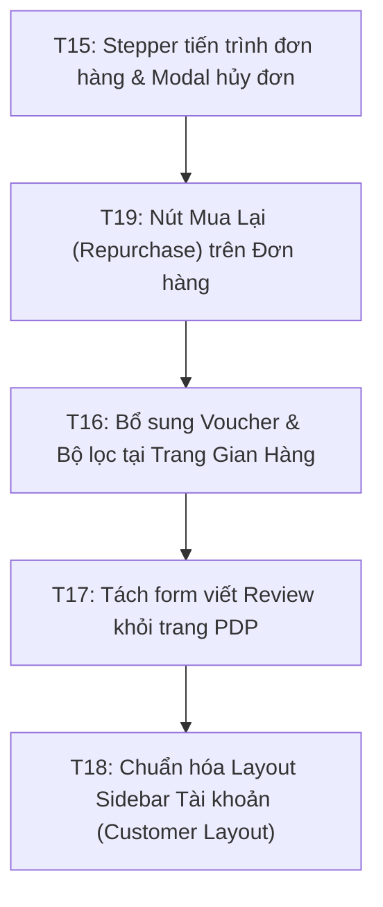

# Báo Cáo Đánh Giá UI/UX & Luồng Nghiệp Vụ Chuyên Sâu — Phần 2 (Desktop)
## Đối chiếu chuẩn Shopee & Lazada: Chi tiết đơn hàng, Gian hàng, Hệ thống Đánh giá & Điều hướng Tài khoản

* **Ngày thực hiện:** 09/11/2026.  
* **Phạm vi kiểm tra:** Desktop **1366 × 768** và **1440 × 900**.  
* **Đối chiếu chuẩn mực:** Shopee Vietnam & Lazada Vietnam Desktop Web.  
* **Khung tiêu chuẩn:** [docs/reviews/REVIEW_FRAMEWORK.md](../REVIEW_FRAMEWORK.md) & [phong-cach-va-goc-nhin-reviewer.md](../phong-cach-va-goc-nhin-reviewer.md).  
* **Tiếp nối:** [shopee-lazada-ux-review.md](./shopee-lazada-ux-review.md) (đã giải quyết T09 – T14).

---

## 1. Kết luận tổng quan

Đợt review Phần 2 tập trung vào 4 luồng nghiệp vụ tương tác sâu sau chuyển đổi (Post-conversion & Discovery):
1. **Theo dõi chi tiết đơn hàng (`OrderDetailPage.tsx`)**
2. **Trang khám phá gian hàng (`StorePage.tsx`)**
3. **Hệ thống đánh giá sản phẩm (`ProductReviews.tsx`)**
4. **Điều hướng tài khoản & Tái đặt hàng (`CustomerSubNav.tsx`, `OrderHistoryPage.tsx`)**

### Vấn đề cốt lõi phát hiện:
* **Đứt gãy luồng hành động tự nhiên:** Trang Chi tiết sản phẩm nhúng thẳng form viết review kèm logic quét toàn bộ đơn cũ của user; trong khi Lịch sử đơn hàng lại thiếu mất nút *"Mua lại"* (Repurchase) — tính năng thúc đẩy doanh số sống còn của Shopee/Lazada.
* **Bố cục điều hướng ngang gây chật chội viewport:** Thanh điều hướng tài khoản `CustomerSubNav` trải dài **11 liên kết ngang** trên đầu mỗi trang con, bẻ gãy thành 2-3 hàng ở độ phân giải 1366 × 768, lãng phí diện tích hiển thị nội dung chính.
* **Trang Gian hàng (Store Page) "chết lâm sàng" về mặt khuyến mãi:** Hoàn toàn không hiển thị Voucher của Shop để khách lưu/thu thập trước khi mua sắm.
* **Trình bày diễn biến đơn hàng dạng ẩn (Hidden Timeline):** Toàn bộ tiến trình giao hàng bị giấu vào `
` đóng mặc định, trong khi form Hủy đơn và Chính sách đổi trả lại mở bung chiếm diện tích cố định trong sidebar.

| Mã | Phân hệ / Màn hình | Phát hiện trọng tâm | Mức độ | Ưu tiên |
|---|---|---|---|---|
| **T15** | Chi tiết đơn hàng (`OrderDetailPage.tsx`, `OrderPresentation.tsx`) | Diễn biến đơn bị giấu trong `
`, trong khi form Hủy đơn và Chính sách lại bung sẵn chiếm trọn sidebar. | **P2** | Trước |
| **T16** | Trang Gian hàng (`StorePage.tsx`) | Thiếu hoàn toàn khối hiển thị/thu thập Voucher của Shop; thiếu bộ lọc danh mục và sắp xếp sản phẩm trong Shop. | **P2** | Trước |
| **T17** | Đánh giá sản phẩm (`ProductReviews.tsx`) | Nhúng form viết review và quét tải toàn bộ đơn cũ ngay trên trang chi tiết công khai; sai lệch ngữ cảnh mua sắm. | **P2** | Trước |
| **T18** | Điều hướng tài khoản (`CustomerSubNav.tsx`) | Dàn trải 11 liên kết ngang gây vỡ dòng trên màn hình 1366x768, thiếu layout 2 cột Sidebar chuẩn Shopee. | **P2** | Tiếp |
| **T19** | Lịch sử đơn hàng (`OrderHistoryPage.tsx`) | Thiếu hành động CTA *"Mua lại"* (Repurchase / Buy Again) trên các đơn hàng đã hoàn tất. | **P2** | Tiếp |

---

## 2. Chi tiết các phát hiện chuyên sâu (T15 – T19)

### T15 — Màn hình Chi tiết đơn hàng: Tiến trình bị giấu, form phụ lại mở bung

* **Mức độ:** **P2** (Đảo lộn ưu tiên tác vụ — Inverted Task Priority).
* **Tái hiện:** 
  1. Đăng nhập tài khoản Khách hàng $\rightarrow$ Mở `/customer/orders/:id`.
  2. Quan sát bố cục trên màn hình **1366 × 768**.
* **Quan sát:**
  * **Tiến trình đơn hàng (`OrderTimeline`):** Bị giấu bên trong một thẻ `

Diễn biến đơn hàng

` đóng mặc định ([OrderPresentation.tsx:208](file:///c:/PBL6/frontend/src/components/OrderPresentation.tsx#L208)). Người mua muốn biết kiện hàng của mình đang ở đâu bắt buộc phải click chuột mở ra xem một danh sách `<li>` gồm timestamp thô.
  * **Sidebar cột phải (`order-detail-sidebar`):**
    * Thẻ `
` ([OrderDetailPage.tsx:238](file:///c:/PBL6/frontend/src/features/customer/OrderDetailPage.tsx#L238)) mở sẵn chiếm hơn $180\text{px}$ chiều cao, nhồi nhét toàn bộ địa chỉ nhận trả và văn bản pháp lý 7 ngày.
    * Form hủy đơn `<form id="cancel">` ([OrderDetailPage.tsx:255](file:///c:/PBL6/frontend/src/features/customer/OrderDetailPage.tsx#L255)) hiển thị một ô `<input>` text rỗng vĩnh viễn trong sidebar, chiếm diện tích dù khách hàng không có nhu cầu hủy.
  * **Cụm thông tin đầu trang (`order-detail-overview`):** Là chuỗi liệt kê các thẻ `
` xếp chồng không có phân cấp: Mã đơn $\rightarrow$ Nút nhắn tin $\rightarrow$ Trạng thái $\rightarrow$ Thanh toán $\rightarrow$ Link thanh toán.
* **Đối chiếu Shopee/Lazada:**
  * **Shopee Order Detail:**
    * Đầu trang là một **Thanh tiến trình ngang đồ họa (Horizontal Step Tracker)** nổi bật:  
      $$\text{Đơn hàng đã đặt} \longrightarrow \text{Đã xác nhận/thanh toán} \longrightarrow \text{Đã giao cho ĐVVC} \longrightarrow \text{Đang giao hàng} \longrightarrow \text{Đã nhận hàng}$$
      Mỗi bước có icon, ngày giờ cụ thể; trạng thái hiện tại sáng đèn cam/xanh. Người mua nhìn vào trong 1 giây là nắm được tình trạng đơn.
    * Nút *"Hủy đơn hàng"*: Là một nút bấm phụ (Secondary Outline Button). Khi bấm mới mở Modal xác nhận và chọn lý do (Đổi ý, Sai địa chỉ, Muốn đổi mã voucher...). Tuyệt đối không để sẵn ô input nhập lý do hủy chiếm diện tích trang.
    * Chính sách đổi trả: Nằm gọn gàng trong 1 link nhỏ hoặc một dòng chú thích dưới chân đơn, không bung chiếm trọn sidebar.
* **Nguyên nhân kỹ thuật:**
  * `OrderDetailPage.tsx` bố trí form hủy đơn dạng static inline thay vì modal.
  * Component `OrderTimeline` dùng native HTML `
` thô sơ thay vì component `ProgressSteps` đã có sẵn trong project (`src/components/ui/ProgressSteps.tsx`).
* **Hướng sửa đề xuất:**
  * Thay thế `<OrderTimeline>` ở đầu trang bằng component tiến trình trực quan (Stepper ngang) dựa trên `data.status` và các mốc thời gian trong `data.timeline`.
  * Chuyển form hủy đơn thành nút *"Hủy đơn hàng"*; khi click mở `ConfirmDialog` hoặc Modal hủy đơn có chọn lý do nhanh.
  * Đóng mặc định hoặc thu gọn chính sách đổi trả thành link tham khảo.
* **Tiêu chí kiểm chứng sau sửa:**
  * Khi mở chi tiết đơn, trạng thái và tiến trình hiện rõ ngay trên màn hình đầu tiên (Above the fold). Không còn form input hủy đơn rỗng nào chiếm chỗ sidebar.
* **Vị trí mã nguồn:**
  * [OrderDetailPage.tsx:202](file:///c:/PBL6/frontend/src/features/customer/OrderDetailPage.tsx#L202)
  * [OrderDetailPage.tsx:238-242](file:///c:/PBL6/frontend/src/features/customer/OrderDetailPage.tsx#L238-L242)
  * [OrderDetailPage.tsx:254-267](file:///c:/PBL6/frontend/src/features/customer/OrderDetailPage.tsx#L254-L267)
  * [OrderPresentation.tsx:203-241](file:///c:/PBL6/frontend/src/components/OrderPresentation.tsx#L203-L241)

---

### T16 — Trang Gian hàng (Store Page) "chết lâm sàng" về mặt khuyến mãi & bộ lọc

* **Mức độ:** **P2** (Thiếu hụt luồng kích thích chuyển đổi — Missing Store Promotion Discovery).
* **Tái hiện:** 
  1. Người mua click vào nhãn Gian hàng của một shop (ví dụ: `/stores/store-uuid`).
  2. Quan sát nội dung trang Shop.
* **Quan sát:**
  * Trang chỉ có: Tên shop, mô tả ngắn, phí ship cơ bản, nút "Nhắn tin", 1 ô input tìm kiếm và lưới sản phẩm phẳng ([StorePage.tsx:105-230](file:///c:/PBL6/frontend/src/features/customer/StorePage.tsx#L105-L230)).
  * **Hoàn toàn không có khối Voucher của Shop:** Mặc dù hệ thống có tính năng Store Voucher (đã dùng tại Checkout), nhưng tại chính "ngôi nhà" của Shop thì khách không thể biết Shop đang có mã giảm giá nào để lưu/sử dụng!
  * **Thiếu hoàn toàn bộ lọc & sắp xếp:** Không có lọc theo Danh mục sản phẩm của shop, không có sắp xếp theo Giá (tăng/giảm), Bán chạy hay Hàng mới về.
* **Đối chiếu Shopee/Lazada:**
  * **Shopee Shop Page:**
    * **Header Profile:** Avatar shop, Tên shop, Nút Chat, Nút Theo dõi, Tỉ lệ phản hồi chat (>95%), Đánh giá (4.9/5 sao), Số lượng sản phẩm.
    * **Khối Mã giảm giá của Shop (Voucher Carousel):** Hiển thị ngay dưới Header các thẻ Voucher (Giảm 10k, Giảm 15%, Đơn tối thiểu...) kèm nút **"Lưu"** để khách bấm thu thập vào tài khoản trước khi mua hàng.
    * **Thanh công cụ phân loại:** Tab "Tất cả sản phẩm", "Bán chạy", "Mới nhất", "Giá: Thấp đến Cao".
* **Nguyên nhân kỹ thuật:**
  * `StorePage.tsx` chưa gọi API lấy danh sách voucher của shop (`listStoreVouchers` hoặc tương đương) và chưa tích hợp component `VoucherCard`.
  * Query sản phẩm trong shop (`listStoreProducts`) chưa truyền tham số `sort` hay `category_id`.
* **Hướng sửa đề xuất:**
  * Bổ sung khối hiển thị **Mã ưu đãi của Gian hàng** (nếu shop có voucher đang hoạt động).
  * Thêm thanh toolbar sắp xếp (Mới nhất, Giá tăng/giảm, Bán chạy) tương tự trang tìm kiếm chung.
  * Tinh chỉnh Shop Header thành Banner chuyên nghiệp có nút Nhắn tin và các thống kê cơ bản.
* **Vị trí mã nguồn:**
  * [StorePage.tsx:105-150](file:///c:/PBL6/frontend/src/features/customer/StorePage.tsx#L105-L150)

---

### T17 — Hệ thống Đánh giá sản phẩm nhầm lẫn giữa "Đọc nhận xét" và "Viết đánh giá"

* **Mức độ:** **P2** (Lỗi ranh giới ngữ cảnh & Tải dữ liệu lãng phí — Context Leakage & Wasteful Queries).
* **Tái hiện:** 
  1. Đăng nhập tài khoản khách hàng đã từng mua sản phẩm A.
  2. Truy cập vào trang chi tiết sản phẩm A: `/products/:id`.
  3. Cuộn xuống phần "Đánh giá sản phẩm".
* **Quan sát:**
  * Dưới danh sách đánh giá của các khách hàng khác, component render nguyên một form:  
    `<h4>Viết đánh giá</h4>` kèm dropdown `<select aria-label="Mục đơn hàng">` ([ProductReviews.tsx:392-419](file:///c:/PBL6/frontend/src/features/customer/ProductReviews.tsx#L392-L419)).
  * Khách hàng phải tự chọn xem mình đang đánh giá cho lần mua nào trong dropdown: `Đơn #2EC54E27 · Áo thun (Đen, L)`.
  * **Hậu quả hiệu năng:** Mỗi lần bất kỳ user đăng nhập nào mở bất kỳ sản phẩm nào, `ProductReviews.tsx` đều chạy vòng lặp tải toàn bộ đơn hàng `COMPLETED` trong lịch sử (`listOwnOrders` loop ở dòng 114-121) và tải toàn bộ đánh giá đã viết (`listOwnReviews` ở dòng 134-140) chỉ để xem user có quyền đánh giá sản phẩm này hay không!
* **Đối chiếu Shopee/Lazada:**
  * **Nguyên tắc phân định ranh giới (Domain Boundary):**
    * **Trang Sản phẩm (PDP):** $100\%$ dành cho người mua tiềm năng **ĐỌC & LỌC đánh giá**. Cung cấp các nút lọc sao: *Tất cả (1.2k) \| 5 Sao (980) \| 4 Sao (120) \| Có bình luận (450) \| Có hình ảnh (200)*.
    * **Hành vi Viết đánh giá:** Nằm tại luồng **Quản lý đơn mua (`/user/purchase`)**. Sau khi đơn hàng chuyển sang trạng thái "Đã nhận hàng", cạnh mỗi sản phẩm có nút **"Đánh giá"** $\rightarrow$ Click mở Modal đánh giá (chấm sao + nhận xét) gắn liền đúng với ID của dòng đơn hàng đó, không bao giờ bắt user phải chọn lại đơn hàng từ một dropdown rùa bò.
* **Nguyên nhân kỹ thuật:**
  * Thiết kế gộp chung (coupled) giữa `ProductReviews` (hiển thị public) và `ReviewForm` (thao tác riêng tư của người mua) trong cùng một component.
* **Hướng sửa đề xuất:**
  * Tách biệt hoàn toàn: Trang PDP chỉ hiển thị danh sách nhận xét, phân bố sao và bộ lọc sao.
  * Việc viết đánh giá chuyển hẳn thành **Modal Đánh giá** kích hoạt từ nút *"Đánh giá sản phẩm"* trên trang Đơn hàng (`/customer/orders` hoặc `/customer/orders/:id#order-items`).
  * Loại bỏ vòng lặp query `listOwnOrders` nặng nề trên trang chi tiết sản phẩm công khai.
* **Tiêu chí kiểm chứng sau sửa:**
  * Trang PDP tải nhanh, không gọi ngầm hàng loạt API đơn hàng của user; không còn form viết review kèm dropdown chọn đơn hàng lạc lõng ở chân trang sản phẩm.
* **Vị trí mã nguồn:**
  * [ProductReviews.tsx:111-140](file:///c:/PBL6/frontend/src/features/customer/ProductReviews.tsx#L111-L140)
  * [ProductReviews.tsx:390-467](file:///c:/PBL6/frontend/src/features/customer/ProductReviews.tsx#L390-L467)

---

### T18 — Thanh điều hướng tài khoản `CustomerSubNav` gây tràn màn hình và vỡ dòng

* **Mức độ:** **P2** (Quá tải nhận thức & Lãng phí không gian màn hình — Horizontal Clutter).
* **Tái hiện:** 
  1. Mở bất kỳ trang quản lý tài khoản nào: `/customer/orders`, `/customer/addresses`, `/customer/reviews`...
  2. Kiểm tra trên màn hình **1366 × 768**.
* **Quan sát:**
  * `CustomerSubNav.tsx` liệt kê **11 liên kết ngang**:  
    `Thông tin cá nhân | Sổ địa chỉ | Đơn hàng của tôi | Tin nhắn | Thông báo | Đổi trả | Yêu thích | Đánh giá của tôi | Lời mời Store | Mở gian hàng | Cài đặt` ([CustomerSubNav.tsx:4-16](file:///c:/PBL6/frontend/src/features/customer/CustomerSubNav.tsx#L4-L16)).
  * Trên màn hình 1366 × 768 hoặc khi cửa sổ trình duyệt thu hẹp nhẹ, 11 liên kết này bị wrap thành 2 đến 3 hàng lộn xộn, chiếm tới hơn **$110\text{px}$** chiều cao ngay dưới Header chính.
  * Người dùng bị hoa mắt trước một "rừng" nút bấm dàn hàng ngang trước khi kịp nhìn thấy nội dung trang mình cần xem.
* **Đối chiếu Shopee/Lazada:**
  * **Shopee & Lazada Desktop Account Center:**
    * Luôn áp dụng bố cục **2 Cột (Master-Detail Layout)**:
      * **Cột trái (Sidebar cố định 200px - 240px):** Avatar + Tên người dùng; Danh mục chức năng dạng dọc có icon rõ ràng:
        * 👤 *Tài khoản của tôi* (Hồ sơ, Địa chỉ, Đổi mật khẩu)
        * 📦 *Đơn mua* (Quản lý đơn hàng)
        * 🔔 *Thông báo*
        * 🎟️ *Kho Voucher*
      * **Cột phải (Content Canvas rộng 80%):** Hiển thị toàn bộ bảng đơn hàng, form địa chỉ hoặc thông tin cá nhân.
    * Bố cục 2 cột giúp mắt quét menu cực nhanh theo chiều dọc, không bao giờ chiếm mất chiều cao hiển thị của nội dung chính.
* **Nguyên nhân kỹ thuật:**
  * Các trang `/customer/*` được code độc lập và chỉ chèn `<CustomerSubNav />` ở đầu trang dạng thanh ngang thay vì dùng chung một layout bọc ngoài (`CustomerLayout` với Sidebar trái).
* **Hướng sửa đề xuất:**
  * Xây dựng `CustomerLayout` chuẩn: Sidebar trái chứa menu tài khoản dọc; phần nội dung bên phải hiển thị trang con.
  * Nếu tạm thời giữ thanh ngang: Thu gọn các mục phụ (`Lời mời Store`, `Mở gian hàng`, `Cài đặt`) vào menu thả xuống hoặc trang Tổng quan tài khoản (`/profile`), chỉ để tối đa 4-5 tab cốt lõi (`Đơn hàng`, `Địa chỉ`, `Đổi trả`, `Yêu thích`).
* **Tiêu chí kiểm chứng sau sửa:**
  * Menu tài khoản không bị vỡ thành 2-3 hàng ngang trên 1366 × 768; chiều cao khu vực điều hướng không vượt quá $45\text{px}$ (nếu dạng tab) hoặc nằm gọn bên cột trái.
* **Vị trí mã nguồn:**
  * [CustomerSubNav.tsx:4-38](file:///c:/PBL6/frontend/src/features/customer/CustomerSubNav.tsx#L4-L38)

---

### T19 — Lịch sử đơn hàng thiếu nút hành động *"Mua lại"* (Repurchase / Buy Again)

* **Mức độ:** **P2** (Bỏ lỡ luồng chuyển đổi sống còn của sàn TMĐT — Missing Repurchase Flow).
* **Tái hiện:** 
  1. Khách hàng vào `/customer/orders` $\rightarrow$ chọn tab *"Hoàn tất"* (các đơn hàng đã giao thành công).
  2. Quan sát các nút hành động của thẻ đơn hàng.
* **Quan sát:**
  * Thẻ đơn hàng chỉ có nút *"Xem chi tiết"* và nút phụ menu ba chấm: *"Yêu cầu đổi trả"*, *"Đánh giá sản phẩm"* ([OrderHistoryPage.tsx:157-198](file:///c:/PBL6/frontend/src/features/customer/OrderHistoryPage.tsx#L157-L198)).
  * Khách hàng hài lòng với sản phẩm và muốn đặt mua lại chính món hàng đó: **Không có bất kỳ nút nào để mua lại**. Khách buộc phải click vào xem chi tiết đơn, click vào từng sản phẩm, chọn lại màu/size, rồi bấm thêm vào giỏ.
* **Đối chiếu Shopee/Lazada:**
  * Trên Shopee và Lazada, tại mọi đơn hàng đã hoàn tất hoặc đã hủy, nút hành động nổi bật nhất (Primary Button màu cam/xanh) luôn là **"Mua Lại"**.
  * Hành vi của nút *"Mua Lại"*:
    * Tự động thêm toàn bộ sản phẩm và đúng phân loại (SKU) của đơn hàng đó vào Giỏ hàng.
    * Hiển thị thông báo: *"Đã thêm X sản phẩm vào giỏ hàng"* kèm nút dẫn tới Giỏ hàng để thanh toán ngay.
    * Nếu có sản phẩm trong đơn đã hết hàng/ngừng bán: Tự động cảnh báo và chỉ thêm các món còn hàng.
* **Nguyên nhân kỹ thuật:**
  * Hệ thống chưa thiết kế handler `handleRepurchase(order)` tại component `OrderHistoryPage.tsx`.
* **Hướng sửa đề xuất:**
  * Thêm nút CTA **"Mua lại"** (variant `primary` hoặc `secondary`) trên thẻ đơn hàng đã hoàn tất / đã hủy.
  * Khi click, gọi hàm thêm hàng loạt sản phẩm trong đơn vào giỏ hàng (`addCartItem`) và điều hướng tới `/cart`.
* **Tiêu chí kiểm chứng sau sửa:**
  * Khách hàng có thể đặt lại đơn hàng cũ chỉ với 1 cú click chuột từ trang Lịch sử đơn hàng.
* **Vị trí mã nguồn:**
  * [OrderHistoryPage.tsx:156-200](file:///c:/PBL6/frontend/src/features/customer/OrderHistoryPage.tsx#L156-L200)

---

## 3. Lộ trình triển khai khuyến nghị (Phần 2)

1. **Đợt 1 — Đơn hàng & Mua lại (`T15`, `T19`):**
   * Thay thế timeline `
` bằng thanh Stepper ngang đồ họa tại `OrderDetailPage.tsx`; chuyển form hủy đơn sang Modal.
   * Thêm nút *"Mua lại"* trên các đơn hàng hoàn tất tại `OrderHistoryPage.tsx`.
2. **Đợt 2 — Khuyến mãi Gian hàng (`T16`):**
   * Tích hợp khối Voucher của Shop tại `StorePage.tsx` để người mua thu thập trước khi chốt đơn; bổ sung thanh lọc/sắp xếp sản phẩm trong Shop.
3. **Đợt 3 — Tách biệt hệ thống Đánh giá (`T17`):**
   * Dọn sạch form viết review và các query đơn hàng ngầm ra khỏi trang chi tiết sản phẩm công khai; đưa việc viết đánh giá về đúng Modal trong Đơn hàng.
4. **Đợt 4 — Tinh gọn điều hướng Tài khoản (`T18`):**
   * Tái cấu trúc `CustomerSubNav` thành layout 2 cột Sidebar hoặc thu gọn các liên kết ngang để triệt tiêu tình trạng vỡ 3 hàng trên desktop.

---

## 4. Kỷ luật kiểm thử

* Toàn bộ các phát hiện trên đã được đối chiếu trực tiếp từ mã nguồn thực tế và kiểm tra tính tương thích với hệ thống backend hiện tại.
* Sẵn sàng chuyển giao cho đợt triển khai tiếp theo.
